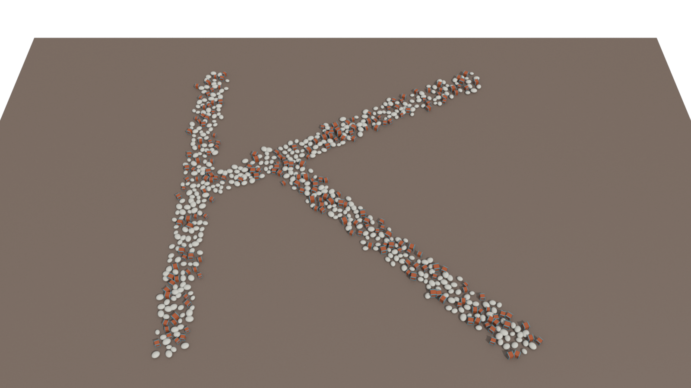
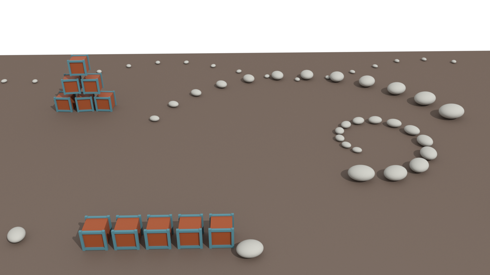
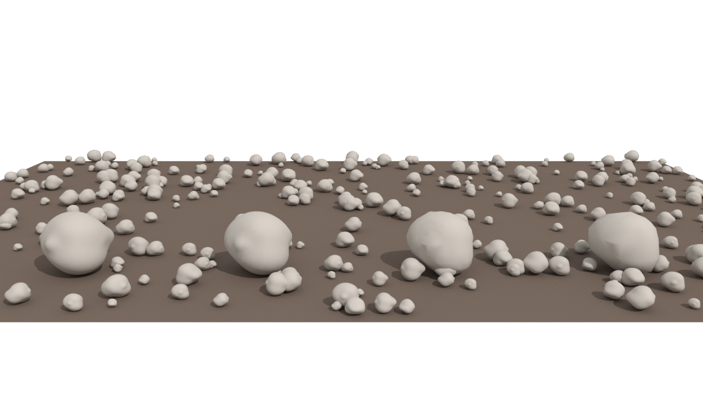
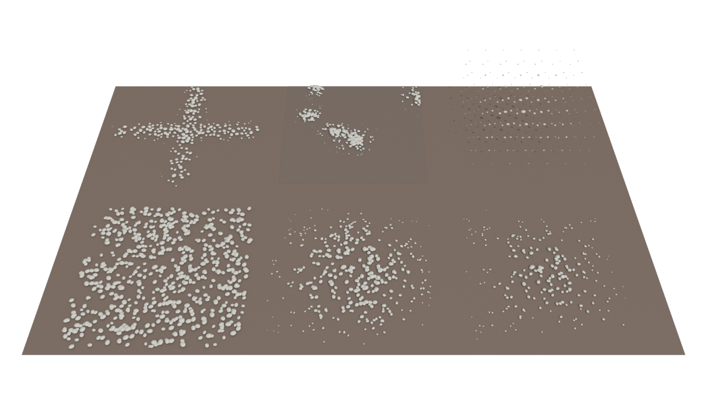

# Arraytron

> **Versioning changed on 2026-10-04.** Releases are now plain `vMAJOR.MINOR.PATCH` (for example `v0.3.5`). The current release is **v1.13.0**; v1.12.0 and everything older are in `dist/archive/` (v0.3.5 was the build earlier called v0.35). Sections below keep their original wording; the old names map as v0.1 = v0.1.0, v0.15 = v0.1.5, v0.16 = v0.1.6, v0.2 = v0.2.0, v0.21 = v0.2.1, v0.3 = v0.3.0, v0.35 = v0.3.5. Scheme, layout and release procedure: `docs/VERSIONING.md`.


# Get Arraytron

A Solaris (LOPs) instancer for Houdini 22 and 20.5 / 21: scatter USD prototypes with a native PointInstancer from lines, areas, grids, circles, curves, surfaces, a viewport brush, clusters or imported FX points.



| | |
| --- | --- |
|  |  |
| **Instance Place**: instances placed one at a time (table and viewport tool), arrays like Copy and Transform, along a curve. | **LOD generator**: reduced copies of the prototypes as LOD 1, LOD 2 and Proxy. |
|  | |
| **Falloff**: scale and density fade from the centre to the edges of any scatter (radial or box). | |

1. Download `Arraytron-<version>.zip` from the [latest release](https://github.com/abdulkarimnoah01/Arraytron/releases/latest).
2. Unzip it and double-click **Install Arraytron.cmd** (no administrator rights; it prepares every Houdini 20.5, 21 and 22 on the PC).
3. Restart Houdini. In a Solaris network press Tab and type *Arraytron*. The demo scenes are in `%LOCALAPPDATA%\Arraytron\versions\<version>\demos`.

**Updating:** click **Check for Updates** on the *Arraytron* shelf in Houdini. It reads the latest release from GitHub, shows what is new and installs it after you say yes; nothing is checked in the background. Details, rollback and publishing a release: `INSTALL.md`.

# Arraytron v1.13.0 (current)

`dist/Arraytron_v1.13.0.hda` (type `arraytron::instancer::1.13.0`) for Houdini 22.0.368 and **`otls_h205/Arraytron_v1.13.0_H205.hda` for Houdini 20.5 and 21** (same node, same parameters, same USD output; built with hython 20.5.445, tested in 20.5.445 and 21.0.440 headless, see `docs/PORT_HOUDINI_205.md`), with the demos in `dist/` and `otls_h205/`; **`Arraytron_v1.1.0_all_demos.hip` (and `Arraytron_v1.1.0_H205_all_demos.hip`) holds every demo as a separate network in one scene.** The installer picks the right build for every Houdini it finds. Start with the **[user guide](docs/USER_GUIDE.md)**; the full list of documents is `docs/INDEX.md`.

A Solaris instancer that scatters USD prototypes with a native UsdGeomPointInstancer. Nine tabs in workflow order: **Prototypes** (Prototype Bank, selection, LOD / proxy prims), **Layout** (Line, Area, Grid, Circle, Curve, Surface, **Paint**, **Cluster**, **Imported Points**, **Instance Place**, and **Falloff**), **Variation** (variation, Mask, **Field Stack**), **Spacing** (**Separation** with priority, **Avoid Geometry**), **Physics** (Physics Settle), **Animate** (Grow), **Optimize** (camera culling, LOD generator, primvars), **Debugging** (instance overrides, debug views), **Export** (USD export, what the node stores).

| Version | Added |
| --- | --- |
| v0.4.0 | Physics Settle (Bullet), cached |
| v0.4.5 / v0.4.6 | Curve and Surface Scatter |
| v0.5.0 / v0.5.1 | Masks (noise, image, mesh primvar); No Overlap |
| v0.5.2 | the six-tab interface and the Grow animation |
| v0.6.0 | the viewport brush (Paint), clearer input sockets |
| v0.7.0 | the Field Stack; the HDA icon |
| v0.8.0 | Cluster; No Overlap merged into Separation & Collision (priority, Avoid Geometry) |
| v0.9.0 | camera optimisation, LOD / proxies, extended primvars |
| v1.0.0 | stable-id audit, **instance overrides**, Paint Replace / Relax, **debug views**, **USD export** and caching strategy, production tests, full documentation |
| v1.1.0 | the **Houdini 20.5 / 21 build** (older Instancer LOP behind the same node; identical USD), installer for 20.5 / 21 / 22 |
| v1.5.0 | **Imported Points**: scatter on FX simulation points and any imported points (SOP or USD) with percentages, scale, rotation and ids for AOVs, in both builds |
| v1.6.0 | **Paint tool shortcuts**: Ctrl erase, Shift relax, Ctrl+Shift drag radius, wheel radius / strength / density, number keys for the operation, live prompt, coloured brush |
| v1.6.1 | Fix: selecting the node no longer switches the Distribution Mode to Paint |
| v1.6.2 | The Settle tab is called **Physics** |
| v1.7.0 | **Pick Instance**: click an instance in the viewport to create its override row |
| v1.8.0 | **LOD generator**: reduced copies of the prototypes as LOD 1 / LOD 2 / Proxy, by triangle percentage |
| v1.9.0 | **Instance Place**: place instances one at a time (table and viewport tool), like Copy and Transform |
| v1.10.0 | **Instance Place arrays**: Copies with Copy and Transform style steps (rows, spirals, fans) |
| v1.11.0 | **Place tool extras**: drag to turn and scale, snap, Place Along Curve; node name `arraytron1`; Settle Instances |
| v1.12.0 | **Falloff**: scale and density fade towards the edge of any scatter (radial or box) |
| **v1.13.0** | **Falloff follows the mode** (clusters, paint strokes, 3D grid); tabs renamed (Prototypes, Variation, Debugging) and a new **Export** tab |

What v1.0.0 and v1.1.0 guarantee (all tested, `tests/validate_production.py`): a saved scene reloads to the identical result; two separate processes give bit-identical output; every Distribution Mode gives unique, deterministic ids that rotation, scale, weights, selection and masks never change; random parameter fuzzing never produces a Python traceback; the exported USD passes `usdchecker`; every demo cooks.

Rebuild and validate with `C:/Program Files/Side Effects Software/Houdini 22.0.368/bin/hython.exe` (the full command list is in `CLAUDE.md`):

```text
tools/build_arraytron_v03.py v1.13.0
tools/build_demo_v03.py v1.1.0 ; build_demo_grow_v052.py ; build_demo_overlap_v051.py ; build_demo_mask_v050.py ; build_demo_paint_v060.py ; build_demo_fields_v070.py ; build_demo_cluster_v080.py ; build_demo_camera_v090.py ; build_demo_finish_v100.py ; build_demo_physics.py railway|box ; build_demo_all.py
tests/validate_v016.py v1.1.0 (39) ; validate_physics.py (19) ; validate_scatter.py (24) ; validate_mask.py (11) ; validate_overlap.py (6) ; validate_grow.py (8) ; validate_paint.py (16) ; validate_fields.py (16) ; validate_cluster.py (8) ; validate_avoid.py (7) ; validate_camera.py (9) ; validate_polish.py (9) ; validate_production.py (7)
```

Not verified in the Houdini interface (it needs a person): how the eight tabs and the new sections look, the viewport brush in a real viewport, and the icon in the network editor; everything else is covered by executed tests (`STATUS.md`).

---

# Earlier releases (history)

The sections below describe each earlier release as it was written.


# Arraytron v0.5.2

`dist/Arraytron_v0.5.2.hda` (type `arraytron::instancer::0.5.2`) with its demos in `dist/`: `_demo.hip` (main scene), `_grow_demo.hip` (the Grow animation), `_overlap_demo.hip`, `_mask_demo.hip`, `_physics_railway_demo.hip` and `_physics_box_demo.hip` (their frozen results are in `dist/arraytron_cache/`, keep it beside them), plus `dist/test_assets`. Previews in `renders/`: `arraytron_v0.5.2_grow_demo_xpu.png` (6 frames of the animation), `_overlap_`, `_mask_`, `_physics_railway_`, `_physics_box_demo_xpu.png`.

* **A redesigned interface.** The old node had 14 tabs in one row and about 150 parameters. It now has **six tabs in workflow order: Source, Layout, Look, Spacing, Settle, Animate**. In Layout only the active mode's settings are shown (under a heading), and specialist settings sit in collapsible "... Details" sections. Parameter names, defaults and menus are unchanged (tested), so scripts and the viewport handle keep working. The design was reviewed by Codex (gpt-6-astra, medium effort); decisions in `team/v052-codex-ui/lead_review.md`.
* **Grow animation (Animate tab).** Instances grow or climb out of the ground in a **sweep across the layout** driven by the timeline: Sweep Direction (X / Y / Z / custom / outward from the centre / point order), Start Frame, Sweep Duration, Grow Time, Random Delay, Style (**Grow**, **Plant** = taller first then wider, **Rise** = pop up out of the ground), Easing (Linear, Smooth, Overshoot, Bounce). Not-yet-started instances are hidden (`invisibleIds`), finished ones are exactly the normal result, and a green arrow guide shows the sweep direction. It animates the final (cached) transforms, so Physics Settle is not re-simulated.
* Details, limits and evidence: [docs/INTERFACE_AND_GROW.md](docs/INTERFACE_AND_GROW.md). Masks and No Overlap: [docs/MASKS_AND_OVERLAP.md](docs/MASKS_AND_OVERLAP.md). Physics Settle for artists: [docs/PHYSICS_FOR_ARTISTS.md](docs/PHYSICS_FOR_ARTISTS.md).

Rebuild and validate with `C:/Program Files/Side Effects Software/Houdini 22.0.368/bin/hython.exe`:

```text
tools/make_test_assets_v04.py ; tools/make_test_assets_v045.py        (stone, box, track, curve, terrain, mask blob, fir)
tools/build_arraytron_v03.py v0.5.2
tools/build_demo_v03.py v0.5.2 ; build_demo_grow_v052.py ; build_demo_overlap_v051.py ; build_demo_mask_v050.py ; build_demo_physics.py railway|box
tools/render_demo.py v0.5.2 <overlap|mask|physics_railway|physics_box> 192 ; tools/render_grow_sheet.py v0.5.2 96
tests/validate_v016.py v0.5.2 (39) ; validate_physics.py (19) ; validate_scatter.py (24) ; validate_mask.py (11) ; validate_overlap.py (6) ; validate_grow.py (8)
```

---

# Arraytron v0.5.1 (earlier release: Masks and No Overlap)

`dist/Arraytron_v0.5.1.hda` (type `arraytron::instancer::0.5.1`) and its demos in `dist/`: `Arraytron_v0.5.1_demo.hip` (the main scene with a curve), `_overlap_demo.hip` (as generated | Remove Overlapping | Push Apart), `_physics_railway_demo.hip` and `_physics_box_demo.hip` (stone piles; their frozen results are in `dist/arraytron_cache/`, keep it beside the HIPs), plus `dist/test_assets`. Previews in `renders/`: `arraytron_v0.5.1_overlap_demo_xpu.png`, `arraytron_v0.5.1_physics_railway_demo_xpu.png`, `arraytron_v0.5.1_physics_box_demo_xpu.png`, `arraytron_v0.5.0_mask_demo_xpu.png`.

* **v0.5.0 Masks**: a **Mask** folder gives every point a 0 to 1 weight from fractal **Noise**, an **Image** (Top, Front or mesh UV) or a **Mesh Primvar**, and uses it for **Density** (thin out), **Scale**, or both, with Invert and a Low / High contrast remap. Works in every Distribution Mode; survivors keep their ids and positions; raising a weight only adds points.
* **v0.5.1 No Overlap**: a **No Overlap** folder keeps instances from sitting inside each other. **Remove Overlapping** deletes the later point of every overlapping pair (stable, ids kept); **Push Apart** slides overlapping points apart (Iterations, Strength); **Spacing** tweaks the required distance (1 = bounding spheres touch, 0.7 lets them sink 30%, 1.5 leaves a gap); sizes come from the real prototype geometry or a Fixed Radius.
* A plain-language guide to Physics Settle for artists: [docs/PHYSICS_FOR_ARTISTS.md](docs/PHYSICS_FOR_ARTISTS.md). Masks and No Overlap in detail, with limits and evidence: [docs/MASKS_AND_OVERLAP.md](docs/MASKS_AND_OVERLAP.md).

Everything older (Physics Settle, Curve, Surface Scatter, the Prototype Bank, all modes) is unchanged and bit-identical when the new features are off (tested).

Rebuild and validate with `C:/Program Files/Side Effects Software/Houdini 22.0.368/bin/hython.exe`:

```text
tools/make_test_assets_v04.py ; tools/make_test_assets_v045.py
tools/build_arraytron_v03.py v0.5.1
tools/build_demo_v03.py v0.5.1 ; tools/build_demo_overlap_v051.py ; tools/build_demo_mask_v050.py
tools/build_demo_physics.py railway ; tools/build_demo_physics.py box        (each bakes its cache)
tools/render_demo.py v0.5.1 <overlap|mask|physics_railway|physics_box> 192
tests/validate_v016.py v0.5.1 (39) ; validate_physics.py v0.5.1 (19) ; validate_scatter.py v0.5.1 (24) ; validate_mask.py v0.5.1 (11) ; validate_overlap.py v0.5.1 (6)
```

---

# Arraytron v0.4.6 (earlier release: Surface Scatter)

`dist/Arraytron_v0.4.6.hda` (type `arraytron::instancer::0.4.6`), `dist/Arraytron_v0.4.6_demo.hip` (the earlier scene plus an S bend of crates and barrels along a Curve), `dist/Arraytron_v0.4.6_scatter_demo.hip` (Surface Scatter on a terrain) and `dist/test_assets`. Previews: `renders/arraytron_v0.4.5_demo_xpu.png`, `renders/arraytron_v0.4.6_scatter_demo_xpu.png`. v0.4.5 added the **Curve** distribution and v0.4.6 **Surface Scatter**: two new Distribution Modes that read BasisCurves or meshes from the incoming stage (a prim path, used at its world transform), with tangent / surface-normal alignment through the shared `p@align` hook. Everything older, including Physics Settle, is unchanged and bit-identical when the new modes are not used (tested). Details, controls, limits and evidence: [docs/CURVE_SURFACE.md](docs/CURVE_SURFACE.md).

* **Curve**: Curve Prim and Curve Index; Placement By Count / By Spacing / Random (per curve, ends included, stable under Count); Reverse; Alignment Tangent with Up / Up Vector / Roll.
* **Surface**: Surface Prim (meshes and basic shapes); By Count or By Density; Seed (stable under Count); Normal Face / Smooth; Align to Normal 0 to 1 (Yaw Only then spins about the normal); Offset; Slope Min / Max (exact count).

Rebuild and validate with `C:/Program Files/Side Effects Software/Houdini 22.0.368/bin/hython.exe`:

```text
tools/make_test_assets_v045.py          (curve_s.usda, terrain.usda)
tools/build_arraytron_v03.py v0.4.6
tools/build_demo_v03.py v0.4.6
tools/build_demo_scatter_v046.py
tools/render_demo.py v0.4.6 scatter 192
tests/validate_v016.py v0.4.6           (39 groups)
tests/validate_physics.py v0.4.6        (19 groups)
tests/validate_scatter.py v0.4.6        (24 groups; v0.4.5 runs its 11 curve groups)
```

---

# Arraytron v0.4.0 (earlier release: Physics Settle)

`dist/archive/Arraytron_v0.4.0.hda` (type `arraytron::instancer::0.4.0`; archived, Physics Settle lives on in v0.4.6), the demos `dist/archive/Arraytron_v0.4.0_demo.hip` and `dist/archive/Arraytron_v0.4.0_physics_demo.hip` (the stone pile; its cache is `dist/archive/arraytron_cache/`, keep it beside the HIP), and `dist/test_assets`. Preview: `renders/arraytron_v0.4.0_physics_demo_xpu.png` (Karma XPU). It is v0.3.6 plus the optional **Physics Settle** system: the distribution becomes the spawn state of a Houdini Bullet rigid-body simulation run inside the HDA, and the settled stones (positions and orientations) are frozen in a cache and fed to the same native PointInstancer. Off by default, and with it off every output array is bit-for-bit the v0.3.6 result (tested). Full description, controls, accuracy and performance numbers: [docs/PHYSICS_SETTLE.md](docs/PHYSICS_SETTLE.md).

How to use it: build a distribution as usual (Area for a bed of stones; count, size, Randomize and the Prototype Bank are the spawn region, count and variation), switch **Physics Settle** on, press **Simulate & Cache**. Stones collide with each other, with the **Ground Plane** and with the meshes named in **Collider Prims**. Any change to any setting shows the unsettled spawn state until you simulate again (the status line says so); changing it back reuses the old cache file.

| Control | Meaning |
| --- | --- |
| Physics Settle | Off: v0.3.6 behaviour. On: simulate. While on, the Bounds Transform is applied to the points in world space (Scale moves stones apart, never stretches them; Scale Instances is ignored). |
| Drop Height, Avoid Overlap At Spawn, Seed | Height of the lowest stones above the distribution plane; lifts overlapping stones just clear of each other so the solver never starts interpenetrating; Seed picks which stones end up on top. |
| Gravity, Density, Friction, Bounce, Air Drag | Scene units per second squared (assumes meters); kg/m3; stone friction (ground and colliders are fixed at 1, so this is the combined value); restitution; and a quadratic air drag that levels the fall speed at about sqrt(Gravity/Drag) so a pour lands as a tight pile instead of scattering. |
| Simulation Duration, Collision Quality | Longest time to simulate (it stops early once the pile is at rest); Draft / Standard / High proxy detail, collision margin, substeps and iterations. |
| Ground Plane, Ground Height, Collider Prims | Infinite static plane; prim path patterns of meshes or cube/sphere/cylinder/cone/capsule prims in the incoming stream, used as static triangle meshes at their world transform. |
| Simulate & Cache, Clear Cache, Cache Folder | Run and freeze the simulation; delete this node's cache files; where they live (`$HIP/arraytron_cache`). The file name is a fingerprint of the whole simulation state. |

Rebuild and validate with `C:/Program Files/Side Effects Software/Houdini 22.0.368/bin/hython.exe`:

```text
tools/make_test_assets_v04.py          (stone.usda, ballast_ground.usda, track.usda)
tools/build_arraytron_v03.py v0.4.0
tools/build_demo_v03.py v0.4.0
tools/build_demo_physics_v04.py 1100   (bakes the pile, about a minute)
tools/render_physics_demo_v04.py 256   (Karma XPU)
tests/validate_v016.py v0.4.0          (everything v0.3.6 checked, on the v0.4.0 HDA)
tests/validate_physics.py              (17 Physics Settle groups; tests/bench_physics.py makes the accuracy/performance table)
```

`ARRAYTRON_MUTATE=quat|noscale|protoframe|nostack|key|hull|world|friction|gravity|groundheight|nocolliders tests/validate_physics.py` runs the suite against deliberately broken code; it must fail, and it does.

---

# Arraytron v0.3.6 (previous release)

`dist/Arraytron_v0.3.6.hda` (type `arraytron::instancer::0.3.6`) and `dist/Arraytron_v0.3.6_demo.hip` (keep `dist/test_assets` beside it). Preview: `renders/arraytron_v0.3.6_demo_xpu.png`. It is v0.3.5 plus the **shared variation extras** (master plan section 16) in the Randomize section; everything else is unchanged. With the new defaults the output is **identical to v0.3.5, array for array** (checked against the real v0.3.5 HDA). v0.3.5 is now in `dist/archive/`.

**Randomize** (Seed and Position are as before; every random draw is keyed on the stable point id and the Seed, so adding points never reshuffles earlier ones):

| Control | Meaning |
| --- | --- |
| Rotation Variation | **Euler XYZ** (default): the existing Rotation (deg) +/- amount per axis; an amount of 0 locks that axis. **Yaw Only**: one `Yaw (deg)` +/- range added to the Y Euler angle; the X/Z amounts are hidden and ignored but keep their values. Either way the variation is added to Instance Transform > Rotation, so a tilted Instance or Bounds Rotation still tilts the result. Yaw Only with yaw T is exactly Euler (0, T, 0). |
| Scale Variation | **Fraction +/-** (default): Base Scale x (1 +/- Amount), 0 to 0.99. **Min / Max**: Base Scale x a uniform number between `Minimum Multiplier` and `Maximum Multiplier` (swapped if reversed, with a warning label; never below 0.0001). Both are uniform on every axis. These are multipliers, not final sizes: per-prototype Scale, Non-Uniform and Bounds Scale multiply on top. |
| Non-Uniform (0 = locked) | An extra independent +/- fraction (0 to 0.99) on each axis, on top of the uniform variation, in either scale mode. 0 on an axis locks it. `(0, 0.3, 0)` makes crates that vary in height only. Enabling it never changes the uniform draw. |

Demo: the Area uses Yaw Only 180 and a Scale Min / Max of 0.75 to 1.35; the Grid uses Non-Uniform (0, 0.35, 0) so every crate has a different height.

Rebuild and validate with `C:/Program Files/Side Effects Software/Houdini 22.0.368/bin/hython.exe`:

```text
tools/build_arraytron_v03.py v0.3.6
tools/build_demo_v03.py v0.3.6
tests/validate_v016.py v0.3.6
```

`ARRAYTRON_MUTATE=yawmode|scalerange|nustream|nuaxis` (plus the older circle, arcstep, facing, align, cycle, cdf, protoscale, protorot, rowid, fold, grid, line, scaleinst) runs the suite against deliberately broken VEX; it must fail, and it does.

---

# Arraytron v0.3.5 (earlier called v0.35)

`dist/archive/Arraytron_v0.3.5.hda` (type `arraytron::instancer::0.3.5`) and `dist/archive/Arraytron_v0.3.5_demo.hip` (archived; it uses `dist/test_assets`). Preview: `renders/arraytron_v0.3.5_demo_xpu.png`. It is v0.3 plus the **Circle / Radial** distribution (master plan section 6); everything else (Prototype Bank with four source methods, selection modes, Line/Area/Grid, Bounds Transform with Scale Instances, viewport handle, guide) is unchanged. v0.3 and earlier stay available.

**Circle / Radial** (Distribution Mode `Circle / Radial`):

| Control | Meaning |
| --- | --- |
| Plane | XZ (ground, normal +Y, default), XY (wall facing +Z), YZ (wall facing +X). Angles run counter-clockwise looking down the normal and start at +X on XZ and XY (3 o'clock on a wall: Start Angle 90 puts the first point at the top) and at +Y on YZ. |
| Radius | Default 5. 0 stacks every point at the centre. |
| Count | Default 12, up to 10000. |
| Arc (deg) | 360 = full circle: Count points evenly, Count intervals, the first point is not repeated. Less = an arc: first point at Start, last at Start + Arc, Count - 1 intervals (so spacing jumps just below 360). 0 stacks the points at the Start angle. |
| Start Angle (deg) | Angle of the first point. |
| Facing | None (default, keeps the prototype orientation), Outward, Center (towards the centre), Tangent (counter-clockwise). The prototype forward axis is +Z on XZ, +X on XY, +Y on YZ. |
| Angle Step, Spacing (local) | Read only: the angle between neighbours and the arc distance between point centres (Radius x step in radians). |

Rotation order per instance: the Prototype Bank Rotation Offset first, then Instance Transform > Rotation and Randomize, then Facing last. A model authored facing +X on the ground plane needs a Rotation Offset of (0, -90, 0). Facing at Radius 0 still follows each point angle. The Bounds Transform and handle move, rotate and scale the whole circle; the guide draws the circle or arc, a tick per point (the Start point longer) up to 256 points, and the pivot.

**Alignment hook.** Facing is written by the Circle generator as a point attribute `align` (a quaternion) and composed last by `VARIATION_PROCESSOR`. This is the seed of the master plan shared alignment stage: Curve and Surface (v0.4) will write `align` too instead of each adding its own orientation code.

Rebuild and validate with `C:/Program Files/Side Effects Software/Houdini 22.0.368/bin/hython.exe`:

```text
tools/build_arraytron_v03.py v0.3.5
tools/build_demo_v03.py v0.3.5
tests/validate_v016.py v0.3.5
```

`ARRAYTRON_MUTATE=circle|arcstep|facing|align` (plus the older cycle, cdf, protoscale, protorot, rowid, fold, grid, line, scaleinst) runs the suite against deliberately broken VEX; it must fail, and it does.

---

# Arraytron v0.3.0 (earlier called v0.3)

`dist/archive/Arraytron_v0.3.0.hda` (type `arraytron::instancer::0.30`) and `dist/archive/Arraytron_v0.3.0_demo.hip` (keep `dist/test_assets` beside it; `barrel.usda` and `rock.usda` are new). Preview: `renders/arraytron_v0.3.0_demo_xpu.png`. It keeps everything from v0.21 (Line By Count/By Spacing, Area with Keep Inside, Grid / Matrix, Bounds Transform with Scale Instances, viewport handle, guide) and follows the master plan (`Arraytron_Master_Solaris_Instancer_Prompt.md`, mapping in `docs/MASTER_PLAN_MAP.md`). The earlier HDAs stay available; v0.3 is a new asset type, so existing nodes are not migrated.

**Prototype Bank (Source folder).** A multiparm list of prototypes; each row has:

| Field | Meaning |
| --- | --- |
| Enable | Disabled rows are ignored (not instanced, not hidden, not counted). |
| Source Type | **Prim Path**: a prim in the incoming stream (which also holds everything wired into Prototype Inputs 2-4, merged in). **Input Connection**: wire any LOP (a Reference, a SOP Create, ...) into Prototype Input 2/3/4, pick the input; with no path typed the prim is chosen automatically (the only top-level prim, followed down single-child chains to the first component or geometry; several top-level prims is an error asking for a Prim Path). **USD File**: a USD file on disk (optional prim path; empty uses its default prim), staged as a hidden reference at `<output>_Sources/Proto_NN_name`. **SOP Geometry**: any SOP node path, imported with SOP Import (up to 4 such rows). |
| Weight | Relative weight (any positive numbers). Weighted Random: chance of being picked. Sequential: block size in id order. 0 never selects. Random and Cycle ignore it; all-zero falls back to uniform. |
| Scale / Scale Random | This prototype's own size multiplier, and an extra +/- fraction of variation for it only. |
| Rotation Offset (deg) | Turns this prototype itself (XYZ Euler) before the instance rotation. |

**Selection Mode / Seed.** Random (uniform), Weighted Random (default), Sequential (points in id order in weight-sized blocks), Cycle (round robin in id order). Random draws are keyed on the stable point id and the Selection Seed, so adding points keeps every earlier pick and changing one weight only moves the points that cross a boundary. `Resolved Prototypes` (read only) lists what each enabled row resolved to; a row that cannot be resolved stops the cook with a row-numbered error (disable it to skip it). Two rows that resolve to the same prim are an error; two different prims with the same name are renamed by Houdini (`Rock`, `Rock2`) in bank order. Point attributes `protoindex` (enabled ordinal) and `proto_id` (bank row, stable when other rows are disabled) are written for downstream use.

**Optimize (v0.9.0):** a seventh tab with camera-aware culling (frustum, distance, density, behind camera; instances are hidden through invisibleIds, never deleted), level of detail / proxy prims per Prototype Bank row and extra primvars, see `docs/CAMERA_LOD_PRIMVARS.md`.

**Cluster (v0.8.0)** is a Distribution Mode (groups of instances around centres on a surface); the Spacing tab is now **Separation & Collision**: Remove / Push Apart with a Priority, and Avoid Geometry that keeps instances out of a mesh, shape or curve, see `docs/CLUSTER_AND_SEPARATION.md`.

**Field Stack (v0.7.0):** the Variation tab holds rows of fields (Height, Slope, Noise, Image, Distance, Exclusion) combined into one weight per point, see `docs/FIELD_STACK.md`.

**Inputs.** Four. **1: Scene Stream (terrain, curve, models)** - the scene with the surfaces and curves to scatter on and any models picked by prim path; **2, 3, 4: extra prototype (optional)** - one extra model each, merged into the stream. A curve is a prim in input 1, not a separate input. **Paint (v0.6.0):** Distribution Mode Paint and the Start Painting button give a viewport brush (Add, Ctrl-drag Remove, `[` `]` radius), see `docs/PAINT_BRUSH.md`.

**Modular network** (master plan stage names). LOP side: `merge_inputs`, `sop_stage_1..4` (SOP Import stagers), `SOURCE_RESOLVER` (validates the bank, stages USD files; never creates points or geometry), `USD_COMPILER` (native PointInstancer), `ensure_prototype_visible`, `bounds_guide`, `transform_distribution`, `OUT_ARRAYTRON`. SOP side inside `USD_COMPILER`: `generate_line/area/grid`, `DISTRIBUTION_GENERATOR`, `VARIATION_PROCESSOR`, `PROTOTYPE_ASSIGNMENT`, `OUT_POINTS`. The bank bookkeeping lives in the HDA's PythonModule (`src/arraytron_module.py`) so the resolver, the prototype pattern and the summary cannot disagree.

Rebuild and validate with `C:/Program Files/Side Effects Software/Houdini 22.0.368/bin/hython.exe`:

```text
tools/make_test_assets_v03.py     (barrel.usda, rock.usda)
tools/build_arraytron_v03.py
tools/build_demo_v03.py
tests/validate_v016.py v0.3.0
```

`ARRAYTRON_MUTATE=cycle|cdf|protoscale|protorot|rowid|fold|grid|line|scaleinst` runs the suite against deliberately broken VEX; it must fail, and it does.

---

# Arraytron v0.2.1 (earlier called v0.21)

`dist/archive/Arraytron_v0.2.1.hda` (type `arraytron::instancer::0.21`) and `dist/archive/Arraytron_v0.2.1_demo.hip` = v0.2 plus **Scale Instances** on the Bounds Transform. v0.2 and v0.16 below are unchanged and still available.

**What the Bounds Transform does.** It moves, rotates and scales the whole finished distribution (Line, Area or Grid) as one group: Position moves it in world space (the viewport handle drives this too), Rotation (deg) turns the layout and every instance around the Pivot, Scale stretches the layout, and Pivot (local) is the point Rotation and Scale act around. Order: scale, then rotate, then translate about the Pivot. Line/Area/Grid Size and Count shape the distribution, Instance Transform changes each crate, Randomize varies each crate.

**Scale Instances (new, default off).** A non-uniform Bounds Scale used to stretch every crate along with the layout (Scale 2.4, 1, 1 made flat, wide crates). Now:
- **Off (default):** Scale only moves the instances apart or together; each crate keeps its own size and shape. The VEX scales the point positions about the Pivot and the USD transform carries rotation and translation only.
- **On:** the old behaviour; the whole array is one scaled object and the instances stretch too.
- Placement is identical in both states; only the instance size differs. The bounds guide follows the same scale, so it always matches the instances. Reset Bounds Transform leaves this toggle alone. Keep Inside Area still bounds the jitter in local space before the layout scale.
- Evidence: `renders/arraytron_v0.2.1_scale_compare_on.png` vs `renders/arraytron_v0.2.1_scale_compare_off.png` (same Area, Scale 2.4, 1, 1), and `renders/arraytron_v0.2.1_demo_xpu.png`.

---

# Arraytron v0.2.0 / v0.1.6 (earlier called v0.2 / v0.16)

`dist/archive/Arraytron_v0.2.0.hda` (type `arraytron::instancer::0.20`) is v0.16 plus the **Grid / Matrix** distribution. `dist/archive/Arraytron_v0.1.6.hda` (`arraytron::instancer::0.16`) is the same without Grid. Houdini compares type versions numerically per component, so v0.2 uses `0.20` to sort above `0.16`. Demos: `dist/archive/Arraytron_v0.2.0_demo.hip` (Line, Area, Grid) and `dist/archive/Arraytron_v0.1.6_demo.hip`; keep `dist/test_assets` beside them. Previews: `renders/arraytron_v0.2.0_demo_xpu.png`, `renders/arraytron_v0.1.6_demo_xpu.png`.

**New in v0.16**

- **Line Spacing Mode:** By Count (Count + Length, as before) or By Spacing (Length + Spacing; Count = floor(Length/Spacing)+1, at most 10000, Spacing at least 0.001). In By Spacing the points are centred as a set, so the span they cover can be shorter than Length; read-only `Resulting Count` and `Occupied Length` show it, and the guide marks the Length limits with longer ticks. In By Count a read-only `Spacing (local)` shows Length/(Count-1).
- **Keep Inside Area** (Randomize, Area only, default off): Position jitter is reflected back at the Area rectangle edges (X and Z), so no point leaves the bounds and nothing piles up on the edge. Y jitter is unaffected. Line and Grid ignore it.

**New in v0.2: Grid / Matrix**

- Distribution Mode `Grid / Matrix`; Spacing Mode By Count | By Spacing as in Line. By Count: `Count` X/Y/Z (default 5,1,5 = a flat 5 x 5 grid; raise Y for a 3D matrix; 1..100 each) and `Size (point span)` X/Y/Z (default 10,10,10; first-to-last point centre distance; ignored on an axis whose count is 1). By Spacing: `Spacing` X/Y/Z (default 2; at least 0.001), per-axis count = floor(Size/Spacing)+1, at most 100. `Center` (default on) centres the point span on the local origin; off puts the first point at the origin and extends along +X/+Y/+Z.
- Read-only: `Spacing (local)`, `Resulting Count`, `Occupied Size`, `Total Points`, and a warning label from 100,000 points. Ids run X fastest (`id = i + nx*(j + ny*k)`), so changing the X or Y count renumbers existing points; adding layers along Z keeps them.
- Shares the Bounds Transform, viewport handle, guide (bounding box collapsed on count-1 axes, plus a cross per point up to 256), Instance Transform and Randomize.

Rebuild and validate with `C:/Program Files/Side Effects Software/Houdini 22.0.368/bin/hython.exe`:

```text
tools/build_arraytron_v016.py [v016|v02|v021]
tools/build_demo_v016.py [v016|v02|v021]
tests/validate_v016.py [v016|v02|v021]
```

`ARRAYTRON_MUTATE=fold|grid|line|scaleinst` runs the suite against deliberately broken VEX; it must fail, and it does. v0.15 and v0.1 documentation follows below, unchanged.

---

# Arraytron v0.1.5 (earlier called v0.15)

`dist/archive/Arraytron_v0.1.5.hda` (`arraytron::instancer::0.15`) and `dist/archive/Arraytron_v0.1.5_demo.hip`. v0.1 files remain untouched and are described further below.

**What changed from v0.1**

- **Fixed: Line and Area controls were hidden.** v0.1 menus used string tokens, so the folder conditionals (`{ mode != 0 }`) were always true and both folders vanished from the parameter pane. v0.15 uses numeric menu tokens; verified in the Houdini GUI.
- **Bounds Transform (new, shared by Line and Area):** Position, Rotation (XYZ Euler degrees, slider range +/-180), Scale (positive XYZ), Pivot (local). `P_world = (P_local - Pivot) * S * R + Pivot + Position`. It moves the bounds, the points and the instance geometry together. Switching Line/Area keeps the transform. v0.1's separate per-mode Position/Rotation/Scale/Pivot are gone.
- **Viewport handle:** the stock LOP transform handle is bound to the Bounds Transform (select the node, press Enter in the viewport).
- **Show Bounds Guide:** guide-purpose curves for the Line segment (with direction arrow and per-point ticks) or the Area rectangle, plus a pivot cross. They follow the Bounds Transform and never render in Karma. The Houdini viewport follows the Karma render settings' included purposes (`default`, `render`), which hide guides, so keep the display flag upstream of the Karma Render Settings LOP (the demo does).
- **Reset Bounds Transform** button; prototype/output fields have the viewport prim-picker button.
- Line: Direction Mode X/Y/Z/Custom, Direction (local, Custom only), Count, Length, Center, and a read-only Spacing (local) = Length/(Count-1). Area: Size X, Size Z, Count, Seed. Instance Transform and Randomize are unchanged.

Open `dist/archive/Arraytron_v0.1.5_demo.hip` (keep `dist/test_assets` beside it): a referenced crate drives a custom-diagonal Line and a tilted, scaled Area using the new controls. Preview: `renders/arraytron_v0.1.5_demo_xpu.png`. Install the HDA with Assets > Install Asset Library if the HIP cannot find it.

Rebuild and validate with `C:/Program Files/Side Effects Software/Houdini 22.0.368/bin/hython.exe`:

```text
tools/build_arraytron_v015.py
tools/build_demo_v015.py
tests/validate_v015.py
```

Team roster from v0.15: see `docs/TEAM_ROSTER.md`.

---

# Arraytron v0.1.0 (earlier called v0.1)

Solaris / LOPs HDA for Houdini **22.0**, built and tested with **22.0.368**. One incoming USD prototype becomes one native USD PointInstancer. Point generation and per-instance transforms use VEX.

## Open the demo

Open `dist/archive/Arraytron_v0.1.0_demo.hip` in Houdini 22. The `/stage` network contains:

1. `reference_test_crate`: loads the separate `dist/test_assets/crate.usda` asset at `/World/Props/Crate` through a native Reference LOP.
2. `Arraytron`: ten centered Line instances, length 10, offset Z = -5; output `/World/Arraytron`.
3. `Arraytron_Area`: sixty deterministic random XZ instances in a 10 x 6 region, offset Z = 1, with Y rotation and scale variation; output `/World/ArraytronArea`.
4. A separate referenced floor, camera, dome light, and `karma_xpu` settings.
5. `RENDER_DEMO_XPU`: USD Render ROP configured to render `karma_xpu` with Karma XPU at 1200 x 800.

Select either Arraytron node to adjust its controls. Select `karma_xpu` for the complete scene. The HDA definition is `arraytron::instancer::0.1`, displayed as **Arraytron**. Install `dist/archive/Arraytron_v0.1.0.hda` with Houdini's Assets > Install Asset Library if needed. Keep the HIP and its `test_assets` folder together; reference file paths use `$HIP`.

The actual XPU preview is `renders/arraytron_v0.1.0_demo_xpu.png`; its linear EXR is beside it. Random Area points may overlap: collision avoidance is outside v0.1.

## Artist controls

- **Source:** one exact incoming Prototype Prim path and editable Output Prim Path. Defaults: `/World/Props/Crate`, `/World/Arraytron`.
- **Distribution:** Line or Area; the unused controls are hidden.
- **Line:** Direction Mode X/Y/Z/Custom, custom direction vector, count, nonnegative length, Center, plus Position, Rotation, XYZ Scale, and Pivot. Custom direction is normalized; zero falls back to +X. Length is the local extent before distribution Scale. For count > 1, endpoints span the whole length. Count = 1 starts at the local origin. Zero length intentionally stacks points.
- **Area:** X/Z size, count, seed, plus Position, Rotation, XYZ Scale, and Pivot. Samples are uniform random points in the centered local XZ rectangle. Rotate the whole area to tilt its plane or aim its bounds. Size = 0 collapses that dimension; no volume scatter is added.
- **Whole distribution transforms:** each mode keeps independent controls. Position moves the entire array in world XYZ; Rotation uses XYZ Euler degrees; positive Scale stretches the bounds and instance geometry together. Pivot is local to the distribution. The order is scale, rotate, translate about Pivot. A zero pivot rotates/scales around Position; moving Pivot alone does not move an identity transform. Existing Offset parameter values are retained under the new Position label.
- **Instance Transform:** XYZ Euler degrees and uniform positive scale applied to each copy before the whole distribution transform. Use these for prototype orientation and size within the array.
- **Randomize:** independent seed, symmetric +/- local position and rotation amplitudes, and fractional scale variation in [0, 0.99]. Scale is `base * (1 +/- amount)` with a positive base. Nonzero local Y positional jitter deliberately moves points off the area plane. Changing the Area seed leaves transform random streams alone; changing Position does not reseed anything.

The prototype's local root and descendant transforms are retained once. Placement authored on its external parents is excluded. Author origin-centered prototypes when desired. Output paths must be absolute, outside the source hierarchy, and may replace an existing PointInstancer; incompatible prims produce an error. The original source occurrence is hidden in the output stream. Hidden prototype descendants remain hidden, while the referenced root is visible for instances.

## Internal nodes and data

`validate_source_paths` is a small Python LOP that checks the incoming prim and output path. It creates no points or geometry.

`build_pointinstancer` is Houdini 22's native PointInstancer LOP. Its internal SOP network contains separate `generate_line` and `generate_area` detail wrangles, `distribution_mode` Switch, `modify_point_transforms` point wrangle, `assign_prototype` point wrangle, and `OUT_POINTS` output. The generators produce `P` and stable integer `id`; transforms add quaternion `orient` and vector `scale`; prototype assignment adds integer `protoindex = 0`.

The native LOP consumes those SOP points and writes USD `positions`, `orientations`, `scales`, `ids`, `protoIndices`, and `extent`. It authors a prototype relationship to `<Output Prim Path>/Prototypes/<source name>` using an internal USD reference. Geometry is shared through composition instead of copied per instance. Existing instancer data is overwritten, so reduced counts remove old instances.

`ensure_prototype_visible` is a native Configure Primitive LOP applied only to the referenced prototype root. This handles a source already hidden by an upstream Arraytron. It preserves visibility on descendants. `transform_distribution` is a native Xform LOP authoring an absolute world-space transform on the output PointInstancer, including local pivot. Point positions stay local, and the single USD transform moves both the distribution bounds and actual instances. `OUT_ARRAYTRON` returns the stage.

`dist/archive/Arraytron_v0.1.0_transform_demo.hip` is an additional scene demonstrating custom diagonal Line direction, raised/rotated Line placement, and tilted/scaled Area bounds. Its actual XPU preview is `renders/arraytron_v0.1.0_transform_demo_xpu.png`. The original reference-asset demo remains available with identity rotation/scale on both layouts.

The native PointInstancer LOP is new in Houdini 22; earlier Houdini releases are not supported by this HDA. See the [SideFX PointInstancer documentation](https://www.sidefx.com/docs/houdini/nodes/lop/pointinstancer.html).

## Validation and rebuilding

`tests/validation_v0.1.0.json` records executed Houdini checks, including 48 Line combinations, seeded Area distributions, complete USD arrays and extents, root/parent transforms, invalid paths, hidden descendants, existing output overwrite, and chained instancers. `tests/render_validation_v0.1.0.json` records fresh Karma XPU calls, ten distinct Line silhouettes, and an image comparison showing that Area contributes geometry. All renderer calls must exit 0. The demo is visually inspected as well.

Run with `C:/Program Files/Side Effects Software/Houdini 22.0.368/bin/hython.exe`:

```text
tools/build_arraytron.py --area
tools/build_demo.py
tools/build_transform_demo.py
tests/validate_arraytron.py
tests/validate_renders.py
```

The first script rebuilds the HDA and an initial Line scene. The second builds the requested reference-asset demo. VEX sources live in `src/vex` and are embedded in the packaged HDA; loading it does not depend on those source files.

## Team

The existing account-client team was reused: Codex supervisor/architect/reviewer, Claude coder, and Gemini researcher through Antigravity. Actual contributions, failures, corrective audits, and final review live in `team/`. The local coordinator creates and validates the Houdini deliverables. Account adapters have no API billing fallback.

Spacing mode and future distributions are omitted. This version provides the requested Line + random Area workflow only.
