# Arraytron Stamp

**Place instances by hand in Solaris.** Pick prototypes, click in the viewport, and the node writes one `UsdGeomPointInstancer`. Brushes (Place, Delete, Paint, Group), a ghost preview of the real prototype, stacking on other stamps, a prototype bank with cards and thumbnails, and a sheet that edits many stamps at once.

Houdini 20.5, 21 and 22 &middot; version 0.10.0 &middot; **[User guide (PDF)](docs/guide/Arraytron_Stamp_Guide_0.9.3.pdf)** &middot; [Changelog](CHANGELOG_STAMP.md) &middot; [Install](INSTALL_STAMP.md)

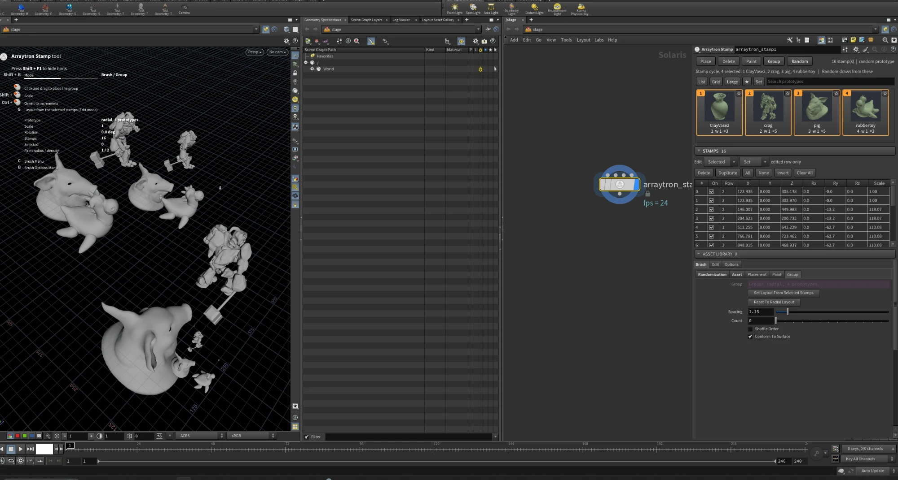

*The viewer with its HUD (left) and the Parameters pane (right): shelf, prototype cards, the STAMPS sheet and the Brush tabs. Houdini sample assets as prototypes.*

## Five steps

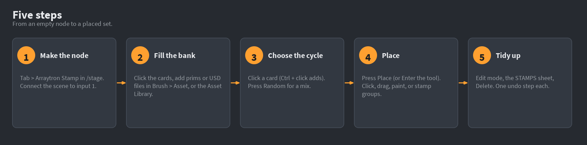

1. **Make the node** in `/stage` and wire your scene (ground, props) into input 1.
2. **Fill the bank**: prims, USD files or the Asset Library. Each row is a card.
3. **Choose the stamp cycle**: click a card, <kbd>Ctrl</kbd> + click adds. **Random** mixes them by weight.
4. **Place**: press **Place** on the shelf (or <kbd>Enter</kbd> in the viewer). Click to place, drag to turn and scale.
5. **Tidy up** with the Edit mode and the STAMPS sheet. Every step is one undo.

## How it works

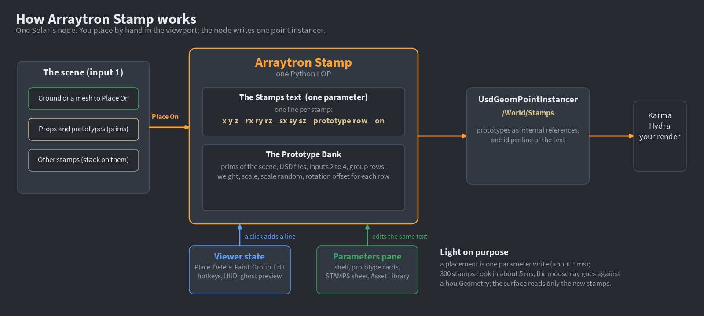

The stamps are **one text parameter** (one line per stamp) and the node is **one Python LOP**, so a placement is one parameter write (about 1 ms) and 300 stamps cook in about 5 ms. The tool and the pane both edit that text.

## The Place brush

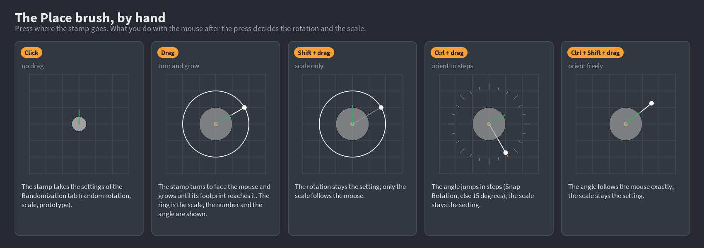

Press where the stamp goes, then drag to turn it to face the mouse and grow it until its footprint reaches it, exactly like Houdini's Layout tool. <kbd>Shift</kbd> scales only, <kbd>Ctrl</kbd> orients to steps, <kbd>Ctrl</kbd>+<kbd>Shift</kbd> orients freely. The ghost shows the prototype itself where it will land.

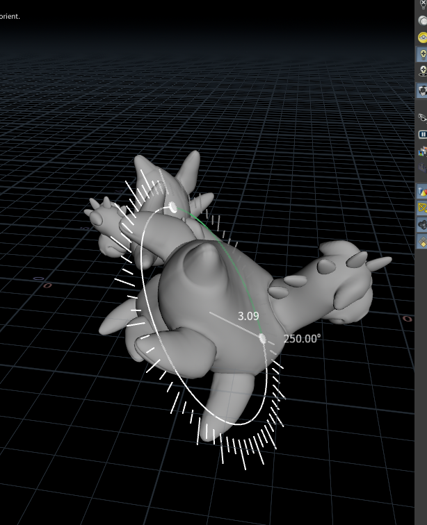

## The stamp cycle and Random

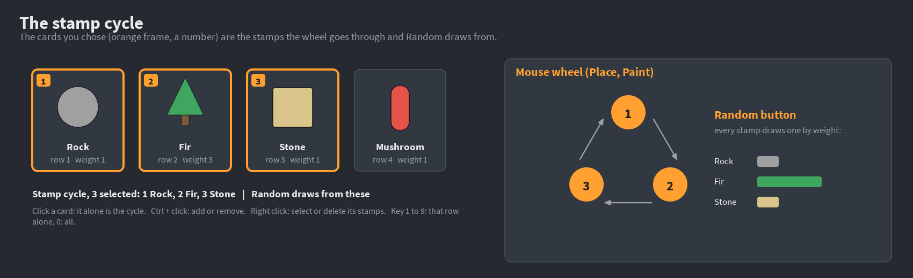

The cards you chose have an orange frame and a number. The mouse wheel goes through them, and Random draws from them by Weight. A line under the shelf names them.

## Up follows the surface, and prototypes sit on it

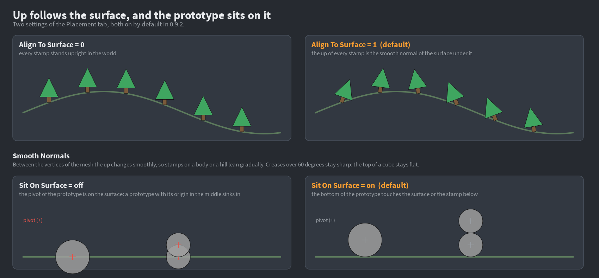

**Align To Surface** (on by default) turns every stamp's up to the **smooth normal** of the surface under it, creases over 60&deg; stay sharp. **Sit On Surface** (on by default) puts the *bottom* of the prototype on the surface instead of its pivot, so a character or a toy stands on the ground, or on top of another stamp, instead of sinking in.

## Randomization

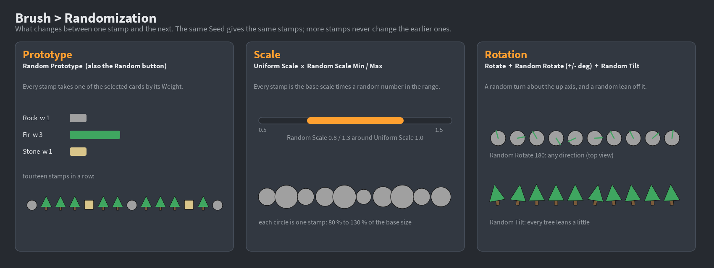

**Brush > Randomization**: Random Prototype, Uniform Scale with Random Scale, Rotate with Random Rotate and Random Tilt, and a Seed. The same Seed gives the same stamps.

## The Group brush

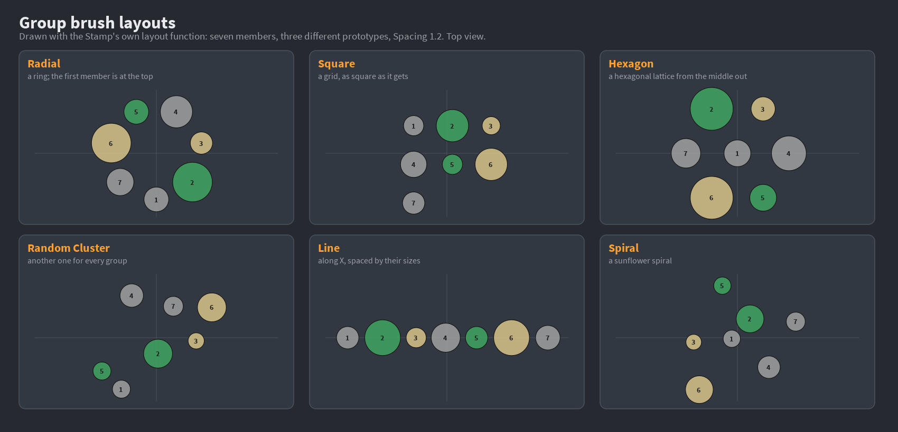

One click stamps several prototypes: a ring of the selected cards by default, or a square, a hexagon, a random cluster, a line, a spiral, or the layout of stamps you placed yourself (select them in Edit mode and press <kbd>G</kbd>). Groups are the same size by default; Random Group Scale, Random Member Scale and Random Member Rotation are there when you want them. Match Member Sizes keeps a small prototype from being lost next to a big one.

## Paint falloff

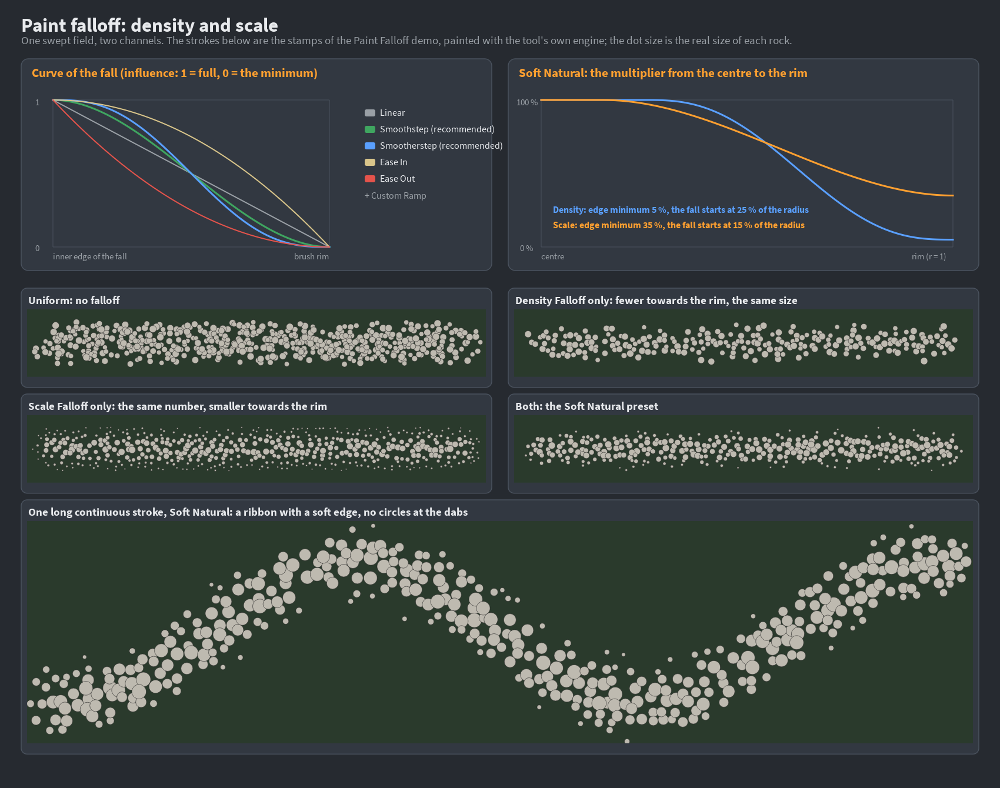

**Brush > Paint > Falloff** thins the stamps (**Density Falloff**) and shrinks them (**Scale Falloff**) towards the rim of the brush. Both read the distance to the *whole stroke*, so a stroke is a ribbon with a soft edge: no circles at the dabs, the same stamps at any mouse speed, and painting the same place again adds nothing. Curves: Linear, Smoothstep, Smootherstep, Ease In, Ease Out or a Custom Ramp; presets Soft Natural, Sparse Edges, Growth, Dense Center. The viewport shows the plateau rings and the two profiles before you paint. Off by default; details in [docs/PAINT_FALLOFF_TECH.md](docs/PAINT_FALLOFF_TECH.md), a demo in `Arraytron_Stamp_v0.9.3_paint_falloff_demo.hip`.

## Managing stamps

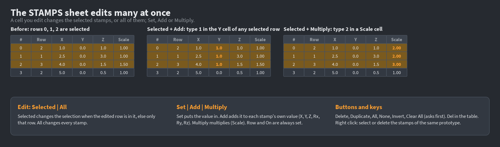

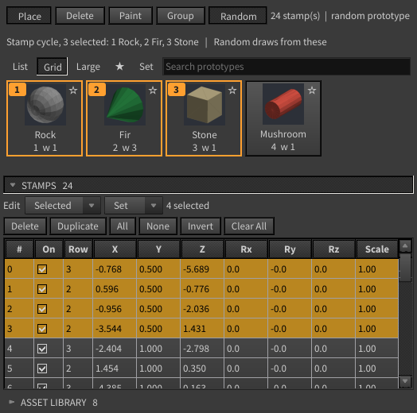

A cell you edit in the **STAMPS** sheet changes the selected stamps or all of them, with Set, Add or Multiply. Delete, Duplicate, All, None, Invert and Clear All sit under the table; right click a row or a card to select or delete every stamp of a prototype.

## Modes and brushes

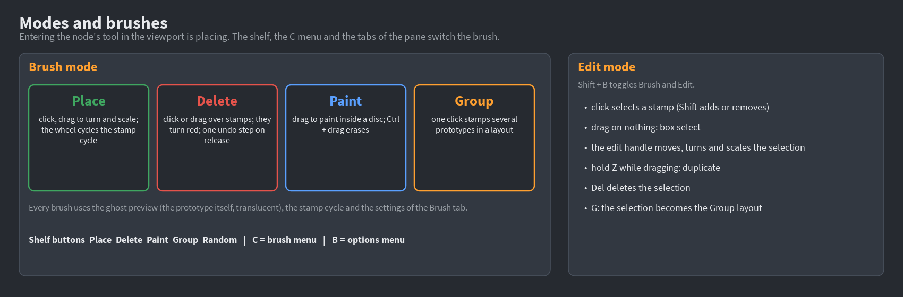

## Light on purpose

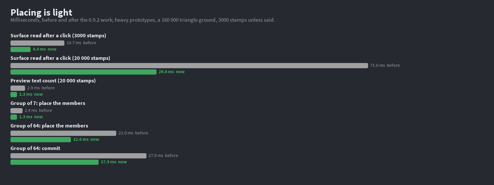

## Install

Unpack `Arraytron_Stamp_v0.10.0_Release.rar`, run **Install Arraytron Stamp.cmd**, restart Houdini. Update with **Check for Updates** on the Arraytron Stamp shelf. Details in [INSTALL_STAMP.md](INSTALL_STAMP.md); everything else in the [PDF guide](docs/guide/Arraytron_Stamp_Guide_0.9.3.pdf) and [docs/ARRAYTRON_STAMP.md](docs/ARRAYTRON_STAMP.md).

## Rebuilding the guide

```
hython tools/build_stamp_guide_art.py     # the diagrams in docs/img (d_*.png)
# panel_*.png are captured from a running Houdini; viewport_drag.png and ui_overview.png are screenshots
# docs/guide/ArraytronStamp_Guide.html -> PDF: Edge or Chrome, --headless --print-to-pdf
```
